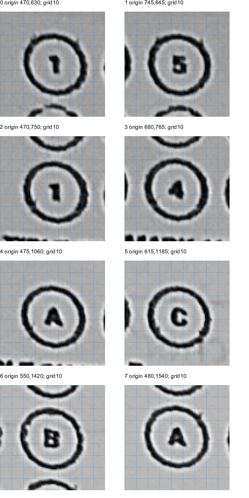
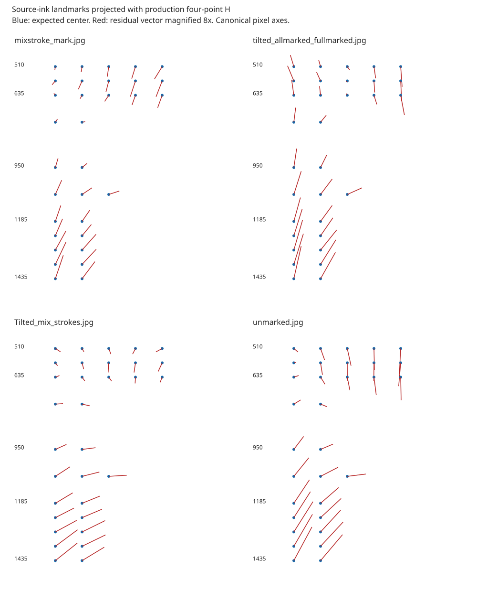
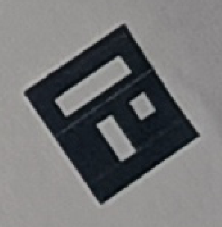
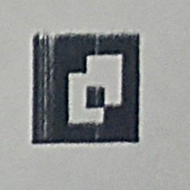

# P15.7 — Geometry root-cause isolation

## A. Baseline and evidence

Branch: `investigation/p15-7-geometry-root-cause`.
Starting commit: `a115e0da0e97cbd8f33ce5d008a10348217616d2` (P15.6).
The six user-staged photographs were preserved in the index and excluded from
the investigation commit. No production engine, camera, tracker, configuration,
classification threshold, or published artifact was modified.

**Outcome:** PDF/layout disagreement was not found. Source-image observations
confirm the photographic registration error independently of the P15.6 ring
search. The physical mechanism causing that error is still unproven. No safe
production geometry correction was established, and answer accuracy did not
improve. The duplicate-marker capture has a separately confirmed explanation:
a real required-ID marker on a neighboring sheet.

Inputs are the same six JPEGs: `unmarked.jpg`, `blank_tilted.jpg`,
`all_marked.jpg`, `tilted_allmarked_fullmarked.jpg`, `mixstroke_mark.jpg`, and
`Tilted_mix_strokes.jpg`. Exact hashes, dimensions, and capture timestamps remain
in [P15.6 inputs](evidence/p15_6/inputs.json). Native replay verified the same
input hashes against P15.6. Keys remain unchanged in
`test/fixtures/p15_6/expected_answers.json`.

Template: `tmpl-87811039040f1a9e6600a2dfff09bfeb`, version 1, 11 questions,
32 bubbles, canonical 2100×2970, A4 physical geometry. The published artifact
SHA-256 is `422052171b90f79e1d3c19060e41975cece2a9daa07e872ef7e330b06637c392`.
The recovered base PDF hash is
`ec6cb2c5dabf1d775a8e5f27da0b7eb5dd12f1b7922109e7bedb99dc88975352`.

During this investigation the user reported **fit to page** and identified
packet PDFs in the phone's Downloads. Read-only recovery found
`p15-5-experiment-packets-p034-2982-p036-1ce4-v1.pdf`. Its three text identities
match the physical sheets: P034-2982 fully marked, P035-A333 mixed, P036-1CE4
blank. The recovered export is preserved as
`test/fixtures/p15_7/packet_print_job.pdf`, SHA-256
`3fb53d05a73ff8d17f23b03bccdebbe562405d0c8272a5f53fa54839448b39f4`.

This closes the missing **packet export** gap from P15.6. It does not recover
the driver/spool output. Printer model, physical media dimensions, margins,
measured printed lengths, a rigid-flat reference capture, camera calibration,
and human-annotated source landmarks remain unavailable. The user did not
confirm whether the sheets were held flat.

## B. Experiments

### A — Published geometry, base PDF, and packet export

Inspected `PageLayout`, `PdfEngine`, `PacketPdfEngine`,
`MarkerCorrespondenceService`, `DetectedRegistrationCorner`,
`CanonicalBubbleMapper`, `HomographyGeometryValidator`, and the OpenCV source
coordinate remapping. The active IDE file `QuestionnairePdfEngine` renders a
separate semantic questionnaire and does not position these answer-sheet ROIs.

The answer-sheet contract is consistent:

* Layout uses millimeters, top-left origin, x right and y down.
* PDF converts physical bounds to points and positions markers, labels and
  circles from those bounds. The packet layer adds identity/header commands
  and retains the base marker and bubble commands.
* Marker bounds include a quiet zone. Detectable black squares use the inner
  `physicalMarkerBounds`, not the quiet-zone rectangle.
* IDs select roles, and marker-local corner order is preserved. Inner corners
  are TL→bottomRight, TR→bottomLeft, BL→topRight, BR→topLeft.
* Both marker and bubble conversion use 10 canonical pixels/mm. Homography
  validation's width−1/height−1 values describe raster boundary probes; they
  do not supply different marker destinations or bubble positions.

Independent rasterization used an **existing installed PDFium DLL**, called
through Python ctypes, at exactly 2100×2970. No packages were installed.
This measures the recovered PDF's ink, rather than drawing another page from
the expected layout. All four PDF pages (base plus three packets) gave:

| Quantity | Layout prediction | Raster observation |
|---|---|---|
| Page | 210×297 mm | 595.275574×841.889709 PDF points; A4 aspect ratio |
| Detectable left marker x bounds | 117.5–222.5 px | black pixel columns 117–222 |
| Detectable right marker x bounds | 1877.5–1982.5 px | columns 1877–1982 |
| Top marker y bounds | 117.5–222.5 px | rows 117–222 |
| Bottom marker y bounds | 2747.5–2852.5 px | rows 2747–2852 |
| All 32 circle centers | saved layout centers | −0.5 px on each axis; Euclidean 0.707 px |
| Circle nominal diameter | 50 px | outer ink extent 52×52 or 52×53 px, including stroke/rasterization |
| Adjacent option spacing | 70 px | 70 px |
| Q1–Q3 row spacing | 62.5 px | alternating 62/63 raster pixels |
| Q7–Q11 row spacing | 62.5 px | alternating 62/63 raster pixels |

Question rows are 510, 572.5, 635, 752.5, 950, 1067.5, 1185, 1247.5, 1310,
1372.5 and 1435 canonical pixels. The three content-column left positions are
255, 800, 1345 px (545-pixel spacing); only the first contains these bubbles.
There are no physical bubble landmarks in the other two content columns to
validate their print output. Observations and actual PDF text are stored in
[PDF provenance](evidence/p15_7/pdf_provenance.json) and the four
`*.bmp.measurements.json` files. A new contract regression compares the production
mapper with these independent saved ink observations for all three packet pages.

An Android `Printing.raster` control also succeeded. Its PdfRenderer uses
integer point dimensions and returned 2099×2966 at requested 254 DPI. It leaves
unpainted paper transparent. Diagnostic handling must composite white and
account for that raster size; simply dropping alpha produces black paper.
The reported measurements above use opaque exact-size PDFium output, avoiding
this diagnostic artifact. No production PDF/scanner change follows from it.

**Printing inference:** any single global affine/projective print transformation,
including uniform fit-to-page scale, global nonuniform x/y scale, and translation,
is absorbed by an exact marker homography when markers and bubbles undergo the
same transformation. Fit to page alone therefore does not explain these local
residuals. Spatially varying printer/feed distortion remains possible. Clipping
cannot explain the blank sheet's interior displacement; all four registration
markers and these bubbles are present. Absolute printed millimeters cannot be
measured from these uncalibrated photographs.

### B — Source-image landmarks and spatial residuals

The new source observation method measures connected dark outer-ink bounds
directly in the original JPEG at intensity <110. Association uses a neighborhood
of the inverse-projected expected location, but the measured centers come from
source pixels, not inverse projections of ring-search maxima. This is an
offline diagnostic, not a new scanner detector or correction table.

It proposes 32 centers on each of the four marker-valid captures. Marked strokes
can touch outlines; thresholding can split broken rings; projective ellipses and
bounding boxes can bias centers. These remain algorithmic observations. They
are not human ground truth and do not validate the two marker-rejected captures.

Eight representative blank-sheet circles were also visually reviewed directly
from fixed source-coordinate crops with 10-pixel rulers. Coordinates and
provenance are in [reviewed landmarks](evidence/p15_7/reviewed_source_landmarks.json).
They are **assistant visual estimates**, with estimated ±1.5 source-pixel
uncertainty, not human annotations. The ring-search result was not used to choose
those visual center coordinates.

| Bubble | Reviewed source center | Four-point displacement |
|---|---|---|
| Q1 option 1 | 517,675 | 2.39 px |
| Q1 option 5 | 791,690 | 13.91 px |
| Q3 option 1 | 518,797 | 2.48 px |
| Q3 option 4 | 724,811 | 10.32 px |
| Q5 A | 520,1108 | 7.31 px |
| Q6 C | 661,1233 | 5.72 px |
| Q9 B | 594,1465 | 14.22 px |
| Q11 A | 524,1584 | 19.27 px |

Exact projected coordinates are in [reviewed projection](evidence/p15_7/reviewed_projection.json).
This set gives four-point mean/P95/max 9.453/19.269/19.269 px; the rejected
multi-point diagnostic gives 8.494/15.473/15.473. Small-sample P95 equals maximum.

The full blank source-ink proposal set gives 9.816/18.453/19.269 px, consistent
with the older ring-search 9.452/17.720/19.925 result within measurement-method
differences. Q1 residual y grows from +1.95 to +13.87 px across its five options.
Q11 A is (+5.92,−18.34). This is not a constant translation or a universal
pixel-center half-pixel error.





The map plots expected centers and magnifies residual vectors eightfold. It
covers the left content strip only, not full-page ground truth.

### C — Error models, held-out rows, and limits

Diagnostic model fitting uses alternating **whole question rows** for fitting
and evaluation, reversing the split and pooling held-out errors. Options from
an evaluation row never enter its fit. No model is deployed or used for OMR.

| Capture | Four-point mean/P95/max | Affine held-out mean | Projective held-out mean | Quadratic held-out mean |
|---|---|---|---|---|
| Mixed flat | 6.234/12.688/13.036 | 1.504 | 1.597 | 1.430 |
| Fully marked tilted | 9.060/17.007/17.915 | 1.182 | 1.040 | 1.018 |
| Mixed tilted | 5.446/11.582/11.952 | 1.568 | 1.552 | 1.321 |
| Blank flat | 9.816/18.453/19.269 | 1.197 | 1.150 | 0.992 |

Translation alone leaves blank held-out mean 9.389 px. Smooth position-dependent
models explain much of the narrow-strip error; an irregular per-bubble shift
is not required to describe these observations. Small differences between the
more flexible models do not identify a physical mechanism.

Crucially, a bubble-only projective fit extrapolates poorly to the 16 detected
marker corners (pooled mean 59.268, max 91.385 px). A diagnostic unweighted linear
projective fit combining all marker corners with training bubbles still leaves
held-out blank bubble mean 9.233, P95 15.788 px. This is not a proof of the best
possible homography: the solver is linear least squares, marker observations
remain detector-derived, and the bubble strip has poor full-page leverage.
It demonstrates why a successful bubble-strip fit must not be promoted as a
trustworthy page transform.

An affine residual field learned from the blank image leaves mean errors
4.055/4.872/5.295 px on mixed-flat/fully-marked-tilted/mixed-tilted. These are
larger than the per-capture held-out fits and can exceed the 4.5-pixel useful
sampling-annulus width. Reusing image-specific offsets is unjustified.

Paper visibly lies on fabric and has creases/uneven edges; the blank source
also has broken printed outlines. Non-planarity is supported but not isolated.
Lens distortion can also cause smooth residuals. No lens calibration, intrinsic
matrix, distortion coefficients, rigid-flat reference, or calibrated straight-line
target is available. Fitting an arbitrary radial/tangential model to one narrow
strip would not distinguish lens distortion from paper or printing. No
undistortion or local production correction was introduced.

### D — Four-point and multi-point cooperation

Both matrices were evaluated on the same source proposals. Multi-point mean
errors were 11.182, 9.022, 5.415 and 8.611 px in the table's capture order.
It is substantially worse on mixed-flat and only marginally better elsewhere.
The first, second and fourth candidates were rejected by existing corner-error
checks. Mixed-tilted was accepted with localized uncertainty, insufficient for
selection over the safe baseline. All production selections remain four-point.
The rejected estimates were projected diagnostically, not used for recognition.

P15.6's full raw inlier distribution/validation details remain authoritative.
No new independent full-page evidence justifies promoting an unsafe estimate.
The baseline policy remains detect once, fit four-point first, invoke multi-point
when needed, warp once, preprocess once, measure once, classify once. Extra
sessions in offline replay are diagnostic work and never run in normal preview.

### E — Actual recognition replay

Native replay ran on the connected Infinix X6711, serial `103212534O103004`.
It used the same six JPEGs, published manifest, preprocessing, classifier and
keys. No candidate correction met the authorization standard, so this is a
baseline reproducibility comparison, not a corrected-engine accuracy result.

| Capture | P15.6 correct | P15.7 correct | Final acceptance |
|---|---|---|---|
| all_marked | marker failure | same failure | no |
| blank_tilted | duplicate failure | same failure | no |
| mixstroke_mark | 3/11 | 3/11 | no |
| tilted_allmarked_fullmarked | 3/11 | 3/11 | no |
| Tilted_mix_strokes | 6/11 | 6/11 | no |
| unmarked | 1/11 | 1/11 | no |

Alignment/recognition completion is 4/6; final acceptance 0/6. Conditional exact
question classification is 13/44 among completed captures. The rejected 22
questions are not silently added to or removed from an overall accuracy claim.
On the blank sheet seven questions still return false selected marks (five
MULTIPLE, two MARKED), three are AMBIGUOUS and one is BLANK. No recovery claimed.

All 12 canonical/normalized/binary PNG pairs are byte-identical to the P15.6
post-optimization run. All four measurement arrays and selected-answer/state
arrays are identical. Native typed-buffer parity again passed: default normalized
max difference 1 and binary difference 0; disabled normalization/denoising exact.

P15.7 replay was built in **debug**, P15.6 timing reference in **profile**.
Preprocessing debug times were 1586.540, 1617.523, 1429.630 and 1597.375 ms
(median 1591.958); profile reference median 454.0985 ms. This is not a matched
performance benchmark or evidence of an engine regression. No production work
was added, so no production-change benchmark is claimed. Downstream replay
totals reuse alignment and must not be called capture-to-result latency.

See [replay comparison](evidence/p15_7/replay_comparison.json),
[native parity](evidence/p15_7/native_parity.json), and existing P15.6 raw
snapshots. Full new native outputs remain under `build/p157-native-complete/`.

### Separate marker failures

`blank_tilted.jpg`: the extra ID13 quadrilateral is at source points approximately
(2669,1702), (2605,1748), (2553,1675), (2619,1629), on a **different sheet** at
the right edge. The intended page's bottom-right ID13 is near (2400,3423).
Both persist at full resolution and without refinement. This is a genuine
duplicate required ID in the scene, not a header-ID6 misdecode. The rejection
is correct; no filtering/identity weakening was implemented.



`all_marked.jpg`: detected ID3 is a packet-header marker near (365,1247), not
the missing ID12 near the opposite page corner. The original ID12 region shows
stripe/dropout/softness in the printed pattern. Baseline, full-resolution and
no-refinement detection all fail to return it; full resolution also loses ID13.
No detected ID12 quadrilateral exists to inspect. The crop supports print/image
quality as a suspect, but does not isolate print damage from detector limitations.
There is no proven safer decoder correction or license to relabel ID3 as 12.



Raw quadrilaterals for all six photos plus the Android base-PDF raster, under
three detector controls, are in [detections](evidence/p15_7/detections.json).

## C. Root-cause matrix

| Symptom | Suspected cause | Supporting evidence | Contradicting evidence | Status |
|---|---|---|---|---|
| Bubble/PDF mismatch | Incorrect saved PDF or packet geometry | Previously missing exact packet export | All 128 raster circle observations and 16 marker bounds agree with layout | Ruled out for recovered exports, within raster precision |
| Large photographic residuals | Wrong units/origin/inner-corner mapping | Would cause systematic offsets | Source audit and independent PDF contract agree; errors vary with position/capture | Ruled out as demonstrated contract defect |
| Residual after fit to page | Uniform/global nonuniform scaling or offset | User confirms fit to page | A common global projective print transform cancels in registration | Ruled out as sole cause under common-transform assumption |
| Smooth capture-dependent displacement | Non-planar paper | Fabric support, creases, changing residual field | No rigid-flat control or measured height field | Supported but unproven |
| Smooth displacement | Lens distortion | Smooth model fits | No calibration; narrow content strip cannot distinguish it from paper/print | Unknown |
| Marker and bubble transforms disagree | Local marker localization error | Unused marker corners disagree with baseline fit | Full-resolution/refinement controls did not recover answers; mapping itself correct | Supported but unproven |
| Physical geometry differs from file | Spatially varying print/feed distortion | Physical circles have uneven/broken ink | No ruler measurements or calibrated scan; packet PDF correct | Unknown |
| Duplicate ID13 | Second sheet in scene | Source quadrilateral directly on neighboring printed marker; stable controls | None | Confirmed |
| Missing ID12 | Print/image quality or detector sensitivity | Poor source crop, persistent detection failure | No independent decoded marker12 observation | Supported but unproven |
| Blank false marks | Wrong local sampled ink | Source centers displaced; identical wrong measurements reproduced | Does not identify upstream physical mechanism alone | Confirmed consequence; upstream cause unresolved |

## D. Correction decision

No production correction was authorized by the evidence. There is no established
incorrect destination coordinate, pixel convention, PDF command or source-unit
conversion to repair. Choosing a bubble-fitted transform would extrapolate outside
its evidence, and selecting rejected multi-point matrices would weaken safety.
No per-bubble shifts, thresholds, new production models or classifiers were added.
The P15.6 typed-buffer optimization remains unchanged.

Changes consist of offline experiment entry point, reproducible raster/source
measurement and model tools, a recovered packet fixture, independent geometry
contract regression, and evidence/report files.

## E. Verification and before/after

Geometry and recognition metrics are above. They are unchanged baseline metrics,
not an improvement from a correction. Existing full/half/crescent/distributed-dot/
X/faint-fill regressions remain enabled; center-excluded dots remain a known
P14.2 limitation, with no exclusion-radius change.

Commands used:

```text
git switch -c investigation/p15-7-geometry-root-cause
flutter build apk --debug --target-platform android-arm64 --no-pub -t lib/debug_p15_7_geometry_main.dart
adb install -r build/app/outputs/flutter-apk/app-debug.apk
adb shell am start -W --user 0 -n com.example.capstone_development/.MainActivity
python tool/p15_7_pdf_raster.py <existing-x64-pdfium.dll>
dart run tool/p15_7_geometry.dart
python tool/p15_7_models.py
python tool/summarize_p15_6.py build/p156-after-complete build/p157-native-complete/baseline docs/development/evidence/p15_7/replay_comparison.json
flutter test --no-pub <five targeted geometry/PDF/alignment/mark-style files> --reporter expanded
flutter test --no-pub test/engines/aruco/p15_7_geometry_contract_test.dart --reporter expanded
flutter analyze --no-pub
dart format --output=none --set-exit-if-changed lib test tool
flutter test --no-pub --reporter expanded
flutter build apk --debug --target-platform android-arm64 --no-pub -t lib/main.dart
git diff --check
```

Targeted existing tests: 82 passed. New contract test: 1 passed. Final analyzer,
format, and comprehensive results are recorded in the handoff below. The initial
analyzer found one diagnostic-tool braces lint; it was fixed before final checks.
There was one initial Android launch error102; retry with `am start -W --user 0`
succeeded. No engine conclusion was drawn from the launch error.

## F. Remaining evidence needed

1. A measured print (marker outer/inner distances, representative row/option
   spacing, paper dimensions), printer/model/media settings, and preferably a
   flatbed scan, to separate spatial printer distortion from photography.
2. Rigid-flat captures of the same sheets, with no other ArUco sheets visible,
   at multiple camera positions. The existing six files alone cannot isolate
   paper height from lens distortion or local corner error.
3. Camera calibration or a rigid straight-line/grid target before any lens
   undistortion change; independently human-reviewed landmarks across the page,
   including areas outside the narrow bubble strip.
4. A clear close-up/reprint of the ID12 region to distinguish print degradation
   from a reproducible native decoder defect.

These are blockers to a justified production geometry correction, not reasons
to relax recognition or identity safety. No further permission is required for
ordinary analysis of supplied evidence; the missing inputs are physical evidence.

## G. Handoff

Branch is listed above. Final investigation commit is the commit containing this
report (`git log -1 --format=%H`); the completion response supplies its exact SHA.
Modified files are the P15.7 report/evidence directory, packet fixture/README,
`lib/debug_p15_7_geometry_main.dart`, `tool/p15_7_geometry.dart`,
`tool/p15_7_models.py`, `tool/p15_7_pdf_raster.py`, and
`test/engines/aruco/p15_7_geometry_contract_test.dart`.

GitHub CI was not run: this branch was not pushed and no remote success is
claimed. Android native replay and parity completed. Normal `lib/main.dart`
was rebuilt for restoration after the experiment. No dependency installation,
clean, preview changes, or production-engine changes were performed.

Final local checks: **751 tests passed, 30 skipped**; analyzer **no issues**;
format check **269 files, zero changes**. Targeted runs passed as listed above.
The normal app was installed successfully and `am start -W --user 0` returned
`Status: ok`. Native parity passed; all four before/after measurement and answer
arrays and all 12 PNG pairs are identical. `git diff --check` passed before commit.
